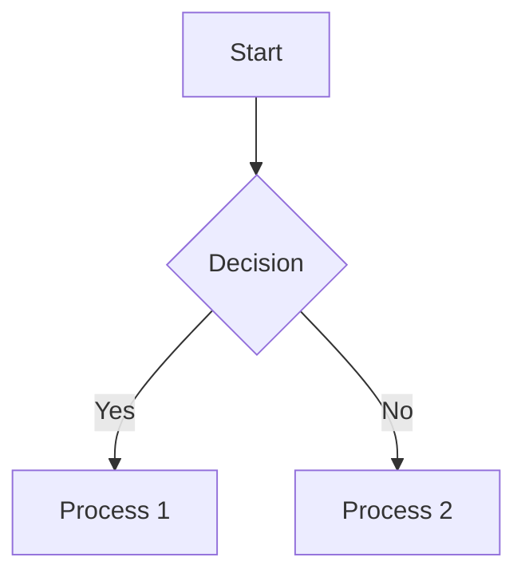
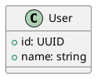

# Technical Documentation Writing Guide

How to write documentation that a reader can actually use.

## When to Use

Load this skill when:
- Writing a README, API reference, or CONTRIBUTING guide
- Documenting code with comments or docstrings
- Writing a tutorial or a step-by-step guide
- Documenting architecture or a design decision
- Setting up a documentation system

## Quick Reference

### Documentation Types
```
README.md         project overview, quick start
API.md            endpoint / function reference
ARCHITECTURE.md   system design, components, data flow
TUTORIAL.md       step-by-step guide for a newcomer
CONTRIBUTING.md   how to build, test, and submit changes
CHANGELOG.md      version history
```

### The one rule
Write for the reader's next action. Every section should answer "what do I do now?" or "why is it this way?" — anything else is decoration.

## README Structure

````markdown
# Project Name

> One-line description of what this is

[](build-url)

## Features
- Feature 1 — what it lets you do
- Feature 2 — ...

## Quick Start
```bash
# install
npm install my-library

# use
import { myFunction } from 'my-library'
```

## Documentation
- [API Reference](API.md)
- [Contributing](CONTRIBUTING.md)
- [Changelog](CHANGELOG.md)

## License
[MIT](LICENSE)
````

### README checklist
- [ ] One-line description at the top
- [ ] Install and first-run instructions that actually work from a clean checkout
- [ ] At least one complete usage example
- [ ] Links to deeper docs
- [ ] License
- [ ] Screenshot or demo for anything visual
- [ ] Table of contents once it grows past ~3 screens

## API Documentation

### REST endpoint
````markdown
### GET /api/users/{id}

Retrieve a user by ID.

**Path parameters:**
- `id` (required): user ID (UUID)

**Headers:**
- `Authorization: Bearer <token>` (required)
- `Accept: application/json` (optional)

**Response 200:**
```json
{
  "id": "123e4567-e89b-12d3-a456-426614174000",
  "name": "John Doe",
  "email": "john@example.com"
}
```

**Errors:**
- `404 Not Found` — no user with that ID
- `401 Unauthorized` — missing or invalid token
````

Document the errors with the same care as the success case; that is the part readers come back for.

### Function / method (Go)
```go
// GetUser retrieves a user by ID.
// It returns ErrNotFound if no such user exists.
func GetUser(ctx context.Context, id string) (*User, error) {
	// ...
}
```
Go convention: the doc comment starts with the identifier name and is a complete sentence. Describe behavior and error semantics, not the implementation.

## Writing Style

### Do
- ✅ Active voice: "Click Save" not "Save should be clicked"
- ✅ Present tense: "Returns the value"
- ✅ Concrete examples over abstract description
- ✅ One term per concept, used consistently throughout
- ✅ Headers that a reader can scan
- ✅ Short paragraphs (3-4 sentences maximum)

### Don't
- ❌ Jargon without a definition on first use
- ❌ Assuming knowledge without a link
- ❌ "Obviously", "simply", "just" — they tell a stuck reader they are stupid
- ❌ Passive voice in instructions
- ❌ Documenting what the code already says

## Code Examples

Good examples are complete, runnable, and commented where the *reason* is not obvious:

```javascript
/**
 * Calculate the total price including tax.
 * @param {number} subtotal  amount before tax
 * @param {number} taxRate   rate as a decimal (0.1 = 10%)
 * @returns {number} total including tax
 */
function calculateTotal(subtotal, taxRate) {
  return subtotal * (1 + taxRate);
}

const total = calculateTotal(100, 0.1); // 110
```

Bad examples name nothing and show nothing:

```python
# ❌ no context, meaningless names
def p(l):
    for i in l:
        print(i)

# ✅ says what it is and what it takes
def print_items(items):
    """Print each item in the list."""
    for item in items:
        print(item)
```

## Diagrams

Use four-backtick fences so the inner block renders (a three-backtick fence inside a three-backtick fence breaks).

````markdown

````

````markdown

````

## Docs Tooling

| Tool | Language | Output |
|------|----------|--------|
| godoc / `go doc` | Go | HTML / terminal from doc comments |
| Swagger / OpenAPI | any | Interactive API reference |
| JSDoc | JavaScript | HTML |
| Sphinx | Python | HTML, PDF, ePub |
| MkDocs / Docusaurus | Markdown | Docs site |

Go projects get API docs for free from doc comments — `go doc ./internal/...` — so keep them accurate rather than duplicating them in a separate file.

## Pitfalls

### Outdated docs
**Problem**: docs describing behavior that no longer exists — worse than no docs.
**Solution**: update documentation in the same change as the code; make docs build in CI; review docs as part of the PR.

### Jargon
**Problem**: the reader stops at the first undefined term.
**Solution**: define on first use, link to a source, and add a Prerequisites section.

### Missing examples
**Problem**: the reader understands the concept and still cannot start.
**Solution**: always include at least one complete, copy-pasteable example; add an advanced one if the feature has depth.

### Wall of text
**Problem**: the reader skips everything and asks anyway.
**Solution**: headers, short paragraphs, tables for options, code blocks for commands.

## Verification

Before publishing:
1. Spell check (`codespell .` or the editor's checker)
2. Link check (`markdown-link-check README.md`)
3. Preview the rendered Markdown — fences and tables are where it breaks
4. Run every command and code example
5. Have someone unfamiliar with the project follow the quick start

## References

- [Google Technical Writing Course](https://developers.google.com/tech-writing)
- [Write the Docs](https://www.writethedocs.org/)
- [Markdown Guide](https://www.markdownguide.org/)
- [API Documentation Best Practices](https://swagger.io/resources/articles/best-practices-in-api-documentation/)
- [Go Doc Comments](https://go.dev/doc/comment)
